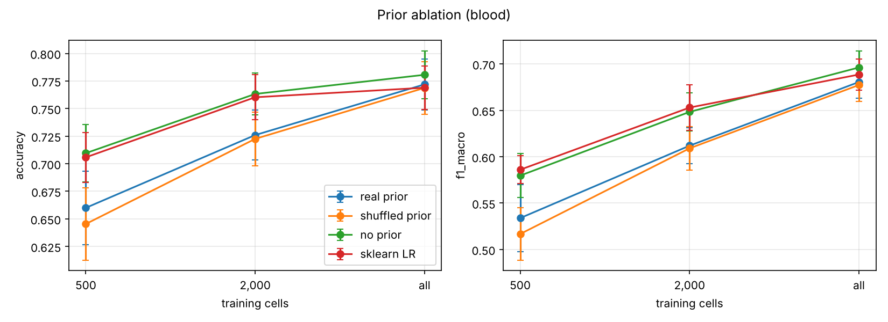
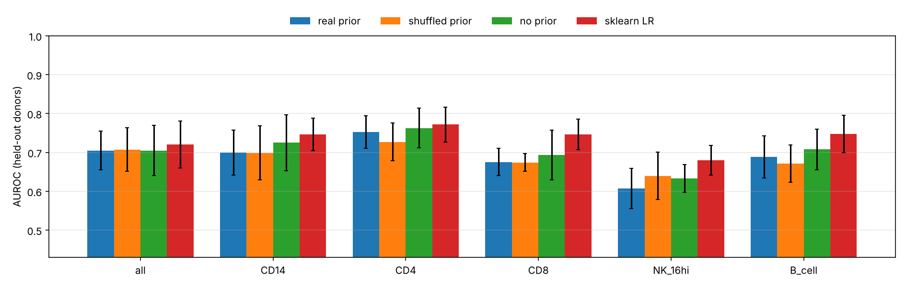
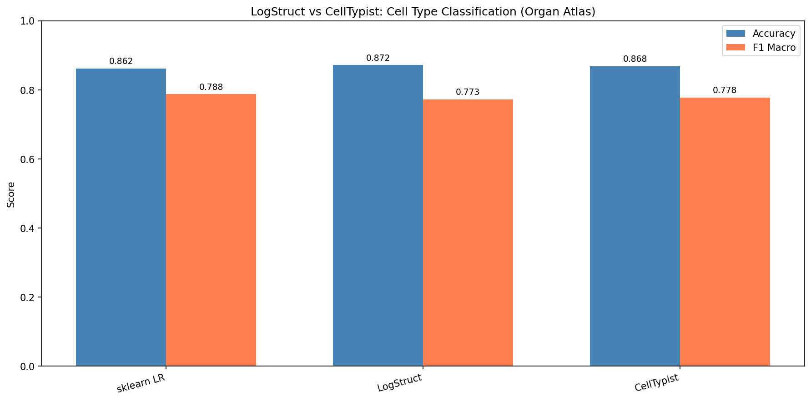
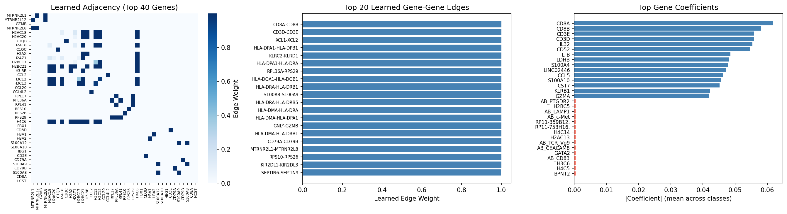

# LogStruct

**Network-structured regression for biological data**

[](https://www.python.org/downloads/)
[](https://opensource.org/licenses/MIT)

LogStruct is a scikit-learn compatible library for logistic and linear regression with **learned feature-graph smoothing**. It's designed for omics data where you have prior knowledge about feature relationships (PPI networks, pathways, gene regulatory networks).

## Why LogStruct?

Standard regularized regression (lasso, ridge, elastic net) treats features as independent. But in biology, genes don't work alone—they interact through pathways, protein complexes, and regulatory networks.

LogStruct lets you:

1. **Incorporate biological priors** — Start with a PPI network, pathway co-membership, or correlation structure
2. **Learn refined structure** — The model adjusts edge weights based on what's predictive in your data
3. **Get interpretable outputs** — Coefficients + a learned network showing which relationships matter

## Installation

```bash
pip install logstruct

# With biology extras (scanpy, anndata)
pip install logstruct[bio]

# For development
pip install logstruct[dev]
```

## Quick Start

```python
from logstruct import LogStructClassifier
from logstruct.priors import from_random

import numpy as np
from sklearn.model_selection import train_test_split

# Your data
X = np.random.randn(500, 100)  # 500 samples, 100 genes
y = (X[:, 0] + X[:, 1] > 0).astype(int)  # binary outcome

# Build a prior (or use from_pathway_gmt, from_string_db, etc.)
prior = from_random(100, density=0.1)

# Fit
clf = LogStructClassifier(
    prior_adjacency=prior,
    lambda_smooth=1.0,  # encourage connected genes to have similar coefficients
    lambda_kl=0.5,      # stay close to prior (increase if prior is reliable)
)
X_train, X_test, y_train, y_test = train_test_split(X, y, test_size=0.2)
clf.fit(X_train, y_train)

# Evaluate
print(f"Test accuracy: {clf.score(X_test, y_test):.3f}")

# Examine learned structure
top_edges = clf.get_top_edges(n=10)
print("Top learned edges:", top_edges)

# Access full learned adjacency
learned_adj = clf.adjacency_  # (n_features, n_features)
```

## Building Priors

LogStruct provides several ways to construct prior adjacency matrices:

```python
from logstruct import priors

# From pathway database (GMT format)
prior = priors.from_pathway_gmt(
    "c2.cp.kegg.v7.gmt",
    gene_names=adata.var_names,
    within_pathway_weight=0.7,
)

# From STRING protein-protein interactions
prior = priors.from_string_db(
    "9606.protein.links.v12.0.txt",
    gene_names=adata.var_names,
    score_threshold=400,  # medium confidence
)

# From gene regulatory network
prior = priors.from_grn(
    tf_target_pairs=[("TP53", "CDKN1A"), ("MYC", "CDK4", 0.9), ...],
    gene_names=adata.var_names,
)

# From data correlation (no external knowledge needed)
prior = priors.from_correlation(X, threshold=0.3)

# Uninformative baseline (let model learn from scratch)
prior = priors.from_identity(n_features, baseline=0.01)
```

## Parameters

### Key hyperparameters

| Parameter | Default | Description |
|-----------|---------|-------------|
| `lambda_en` | 1.0 | Elastic net strength (sparsity on coefficients) |
| `lambda_smooth` | 1.0 | Laplacian smoothness (connected features → similar coefficients) |
| `lambda_kl` | 1.0 | KL divergence to prior (how much to trust your prior) |
| `alpha` | 0.5 | Elastic net mixing: 0=ridge, 1=lasso |
| `temperature` | 0.8 | Adjacency sharpness (lower = more binary edges) |
| `edge_threshold` | 0.1 | Prior entries above this become learnable edges, everything else is fixed at zero |
| `n_candidate_neighbors` | 0 | If > 0, also add each gene's k most correlated genes as candidate edges |
| `class_weight` | None | `"balanced"` reweights the loss so rare cell types count as much as common ones |
| `early_stopping` | False | If True, stop on a held-out validation loss instead of training to convergence |
| `freeze_adjacency` | False | If True, don't learn structure (use prior directly) |

All penalties are divided by the number of training samples, so `lambda_en=1` is the same strength as `C=1` in sklearn and the defaults do not need to change with the number of genes or edges.

### Tuning tips

- **Strong prior (validated PPI network):** High `lambda_kl` (2-10), moderate `lambda_smooth`
- **Weak prior (correlation-based):** Low `lambda_kl` (0.1-0.5), let model deviate
- **Small sample size:** Higher regularization overall, higher `lambda_kl`
- **Discovery mode:** Low `lambda_kl`, examine `clf.adjacency_` vs prior

## Regression

For continuous outcomes, use `LogStructRegressor`:

```python
from logstruct import LogStructRegressor

reg = LogStructRegressor(
    prior_adjacency=prior,
    lambda_smooth=1.0,
)
reg.fit(X_train, y_train)

y_pred = reg.predict(X_test)
r2 = reg.score(X_test, y_test)
```

## How It Works

### Smoothing operator

Before prediction, features are smoothed over the graph:

```
x_smooth = x @ S
```

where `S = I + row_normalize(A)` and `A` is the learned adjacency.

This means each gene's value becomes a weighted average of itself and its network neighbors.

`A` is stored as an edge list. Only edges in the prior (plus optional candidate edges from `n_candidate_neighbors`) have a learnable weight, and every other entry is fixed at zero. So the model has one graph parameter per edge instead of one per gene pair, the smoothing is a sparse matrix product, and the learned graph can only reweight edges that were proposed to it.

### Loss function

```
L = task_loss + (1/n) * [ λ_en * elastic_net(W) + λ_smooth * Σ w^T L w + λ_kl * KL(A || A_prior) ]
```

- **Task loss:** Cross-entropy (classification) or MSE (regression)
- **Elastic net:** Sparsity on coefficients. The L1 part is applied as a proximal (soft-threshold) step, so unused genes get a coefficient of exactly zero
- **Laplacian smoothness:** `w^T L w` penalizes large differences between coefficients of connected features
- **KL divergence:** Keeps learned edge weights close to the prior, summed over edges
- **1/n scaling:** The penalties act like a prior, so they matter most with few samples and fade as more data comes in

### What you get

- `clf.coef_`: Learned coefficients
- `clf.adjacency_`: Learned adjacency matrix (dense up to 5000 features, scipy CSR above that, see `sparse_adjacency`)
- `clf.edges_`, `clf.edge_weights_`, `clf.edge_prior_`: The learnable edges with their learned and prior weights
- `clf.get_top_edges(n)`: Most important learned edges
- `clf.history_`: Training curves

## Example: Cell Type Classification

```python
import scanpy as sc
from logstruct import LogStructClassifier
from logstruct.priors import from_pathway_gmt

# Load data
adata = sc.read_h5ad("pbmc3k.h5ad")
sc.pp.highly_variable_genes(adata, n_top_genes=2000)
adata = adata[:, adata.var.highly_variable]

X = adata.X.toarray()
y = adata.obs["cell_type"].values

# Build prior from KEGG pathways
prior = from_pathway_gmt(
    "c2.cp.kegg.v7.5.symbols.gmt",
    gene_names=adata.var_names.tolist(),
)

# Fit
clf = LogStructClassifier(
    prior_adjacency=prior,
    lambda_smooth=1.0,
    lambda_kl=1.0,
    max_iter=100,
    verbose=True,
)
clf.fit(X, y)

# Which pathway edges are most predictive?
for i, j, w in clf.get_top_edges(20):
    print(f"{adata.var_names[i]} -- {adata.var_names[j]}: {w:.3f}")
```

## Analyzing Learned Networks

LogStruct allows you to quantify how the learned network differs from your biological prior (e.g., discovering new interactions or pruning false positives).

```python
from logstruct.analysis import compare_to_prior, print_network_report

# Run analysis
res = compare_to_prior(
    clf, 
    gene_names=adata.var_names.tolist(),
    prior_threshold=0.5,
    learned_threshold=0.1
)

# Print a formatted report
print_network_report(res)

# Access specific discoveries programmatically
for i, j, w in res['gained'][:5]:
    print(f"New Edge: {adata.var_names[i]} -- {adata.var_names[j]} (Weight {w:.3f})")
```

This will output:
- **Gained Connections:** High-weight edges in the model that were NOT in the prior (potential novel interactions).
- **Lost Connections:** High-confidence prior edges that the model pruned (irrelevant for the specific task).
- **Retained Connections:** Validated prior knowledge.

## Limitations

- **Scalability:** The graph is sparse, but training is still full-batch on a dense expression matrix, so memory grows with cells × genes.
- **Edges come from the prior:** The model reweights the edges it is given. To find edges outside the prior, set `n_candidate_neighbors`.
- **Not a GNN:** This is regularized linear model with graph structure, not a graph neural network. Interpretability over raw power.
- **Edge learning is soft:** Adjacency is probabilistic, not discrete. Threshold for interpretation.

## Prior Ablation: Does the Biology in the Prior Help?

`ablation_prior.py` trains the same model with the same settings and only changes the graph:

- **real prior:** the prior as given
- **shuffled prior:** degree-preserving rewiring of the real prior (`priors.shuffle_degree_preserving`), so hubs stay hubs but the partners are random
- **no prior:** no edges, which is a plain elastic-net linear model

```bash
python ablation_prior.py --dataset synthetic --seeds 5 --n_shuffles 3
python ablation_prior.py --dataset blood --max_cells 20000 --n_genes 2000 \
    --train_sizes 500 2000 0 --seeds 5 --n_shuffles 3
```

### Synthetic data with a known gene-module graph (positive control)

400 training cells, 600 genes, 50% dropout, prior has 70% of the true edges plus the same number of false edges.

| Condition | Accuracy | F1-Macro |
|-----------|----------|----------|
| **real prior** | **46.4% ± 1.3** | **46.3% ± 1.4** |
| shuffled prior | 39.0% ± 0.7 | 38.9% ± 0.8 |
| no prior | 39.2% ± 1.0 | 39.1% ± 1.0 |
| sklearn LR | 39.2% ± 0.4 | 39.1% ± 0.4 |

When the prior matches the real structure, the model gains about 7.4 points over a shuffled prior on all 5 seeds.

### Cell type annotation on the CellTypist Blood atlas with a STRING prior

20k cells, 2000 HVGs, STRING score ≥ 700, 20 cell types, test cells from held-out donors, 5 seeds (mean ± std).

| Training cells | Condition | Accuracy | F1-Macro |
|----------------|-----------|----------|----------|
| 500 | real prior | 66.0% ± 3.3 | 53.4% ± 3.6 |
| 500 | shuffled prior | 64.5% ± 3.3 | 51.7% ± 2.8 |
| 500 | **no prior** | **71.0% ± 2.6** | 58.0% ± 2.4 |
| 500 | sklearn LR | 70.6% ± 2.3 | **58.6% ± 1.5** |
| 2,000 | real prior | 72.6% ± 2.3 | 61.2% ± 1.9 |
| 2,000 | shuffled prior | 72.3% ± 2.4 | 60.9% ± 2.3 |
| 2,000 | **no prior** | **76.3% ± 1.9** | 64.8% ± 2.1 |
| 2,000 | sklearn LR | 76.0% ± 2.1 | **65.3% ± 2.4** |
| all (~14.5k) | real prior | 77.2% ± 2.3 | 68.1% ± 1.8 |
| all (~14.5k) | shuffled prior | 76.9% ± 2.4 | 67.7% ± 1.8 |
| all (~14.5k) | **no prior** | **78.1% ± 2.2** | **69.6% ± 1.8** |
| all (~14.5k) | sklearn LR | 76.9% ± 2.0 | 68.9% ± 1.7 |

What this says:

- **The real STRING prior is slightly better than a shuffled one when cells are few** (+1.5 accuracy points at 500 cells, 5 of 5 seeds), and the gap closes with more cells.
- **Any graph is worse than no graph on this task** (-5.0 points at 500 cells, -0.9 with all cells). Cell types are separated by a few sharp marker genes, and smoothing over PPI neighbors blurs them.
- **Without a graph the model matches sklearn LR.**

So cell type annotation is not the task where the network prior pays off. The synthetic control shows the kind of problem where it does: weak signal spread over gene modules, noisy single genes, and few samples.



### Donor-level phenotype prediction from pseudobulk (COVID-19 PBMC)

This is the setting closest to the synthetic control: few samples (one per donor), many genes, and signal that is expected to sit in pathways. `pseudobulk_task.py` uses the Stephenson et al. 2021 COVID-19 PBMC atlas (647k cells, 120 donors). Counts are summed per donor and cell type, converted to log-CPM, and the top 2000 variable genes are picked on the training fold only. The prior is STRING (score ≥ 700). Every condition is tuned by inner 3-fold CV (LogStruct: `alpha`, `lambda_en`, `lambda_smooth`; sklearn: `C`), and scored by AUROC over 5 x 5 repeated stratified CV on donors.

```bash
python pseudobulk_task.py --task severity
python pseudobulk_task.py --task covid
```

**Severity** (severe or critical vs asymptomatic, mild or moderate, COVID donors only), AUROC mean ± std over repeats:

| Pseudobulk | real prior | shuffled prior | no prior | sklearn LR |
|------------|-----------|----------------|----------|------------|
| all cells | 0.705 ± 0.050 | 0.707 ± 0.056 | 0.705 ± 0.065 | **0.721 ± 0.060** |
| CD14 monocytes | 0.699 ± 0.057 | 0.698 ± 0.069 | 0.725 ± 0.072 | **0.746 ± 0.042** |
| CD4 T | 0.752 ± 0.042 | 0.727 ± 0.049 | 0.763 ± 0.051 | **0.772 ± 0.045** |
| CD8 T | 0.675 ± 0.035 | 0.674 ± 0.023 | 0.693 ± 0.064 | **0.746 ± 0.039** |
| NK (CD16 high) | 0.607 ± 0.052 | 0.640 ± 0.061 | 0.633 ± 0.036 | **0.680 ± 0.039** |
| B cells | 0.688 ± 0.054 | 0.671 ± 0.048 | 0.708 ± 0.052 | **0.747 ± 0.048** |

**COVID vs healthy**, AUROC:

| Pseudobulk | real prior | shuffled prior | no prior | sklearn LR |
|------------|-----------|----------------|----------|------------|
| all cells | 0.962 ± 0.019 | 0.958 ± 0.029 | 0.973 ± 0.010 | **0.980 ± 0.010** |
| CD14 monocytes | 0.969 ± 0.015 | 0.979 ± 0.010 | 0.980 ± 0.015 | **0.984 ± 0.006** |
| CD4 T | 0.923 ± 0.016 | 0.947 ± 0.014 | 0.953 ± 0.013 | **0.955 ± 0.008** |
| CD8 T | 0.952 ± 0.023 | 0.957 ± 0.017 | 0.955 ± 0.021 | **0.960 ± 0.012** |
| NK (CD16 high) | **0.973 ± 0.011** | 0.954 ± 0.015 | 0.961 ± 0.015 | 0.970 ± 0.009 |
| B cells | 0.928 ± 0.029 | 0.932 ± 0.038 | 0.949 ± 0.028 | **0.963 ± 0.011** |

Paired AUROC differences, averaged over the six pseudobulk views:

| Task | real - shuffled | real - no prior |
|------|-----------------|-----------------|
| severity | +0.002 ± 0.016 (3 of 5 repeats) | -0.017 ± 0.014 (1 of 5) |
| COVID vs healthy | -0.003 ± 0.006 (2 of 5) | -0.011 ± 0.007 (0 of 5) |

What this says:

- **The STRING prior does not help here.** Real and shuffled priors are indistinguishable, and both are a little worse than no graph.
- **sklearn LR is the best or tied for best in 11 of 12 rows.** The no-prior model is the same model class, so the remaining gap (about 0.02 to 0.05 AUROC on severity) comes from the optimizer and tuning grid, not from the graph.
- The single consistent win for the real prior is NK cells on COVID vs healthy (+0.019 over shuffled, 5 of 5 repeats). With 12 comparisons, one such result is expected by chance.

Caveats: COVID vs healthy is near ceiling, so it cannot separate methods. Collection site is partly confounded with status in this dataset. The tuning grid was widened (ridge option, smaller `lambda_en`) after a first run where training stalled, so the grid was not fixed in advance. With `lambda_kl=1` the edge weights stay within about 0.01 of the prior, so this tests "smooth over the STRING graph", not "learn a better graph".



## Benchmark: LogStruct vs CellTypist

> **Note:** the numbers in this section were produced with the earlier dense-adjacency version of the model and have not been rerun with the current one.

We benchmarked LogStruct against [CellTypist](https://www.celltypist.org/) (SOTA cell annotation tool) and sklearn Logistic Regression on the CellTypist Blood Organ Atlas (20k cells, 3k HVGs).

### Results

LogStruct achieves **82.0% accuracy** and **66.5% F1-macro**, approaching CellTypist performance (85.2% accuracy) while offering full interpretability.

| Model | Accuracy | F1-Macro | Training Time |
|-------|----------|----------|---------------|
| **CellTypist** | **85.2%** | **74.2%** | 44.7s |
| sklearn LR | 84.7% | 75.0% | 8.6s |
| **LogStruct** | **82.0%** | **66.5%** | 52.5s |

> **Note:** LogStruct used a STRING-DB PPI network prior, 3k HVGs (1.5k selected), and 2000 training iterations.

### Visualizations

#### Performance & Training Time


#### Learned Gene Network
LogStruct learns which biological interactions matter for the classification task:



### Interpretation

- **Competitive Accuracy:** LogStruct is within ~3% of CellTypist accuracy.
- **Interpretable:** Unlike pure linear models, LogStruct provides a sparse, weighted adjacency matrix showing gene-gene dependencies.
- **Biological Prior:** The model effectively filters a dense PPI network (1M+ edges) to the most relevant subnetworks.

## Citation

If you use LogStruct in your research:

```bibtex
@software{logstruct,
  author = {Yash Raj},
  title = {LogStruct: Network-structured regression for biological data},
  year = {2025},
  url = {https://github.com/yashraj/logstruct}
}
```

## License

MIT
